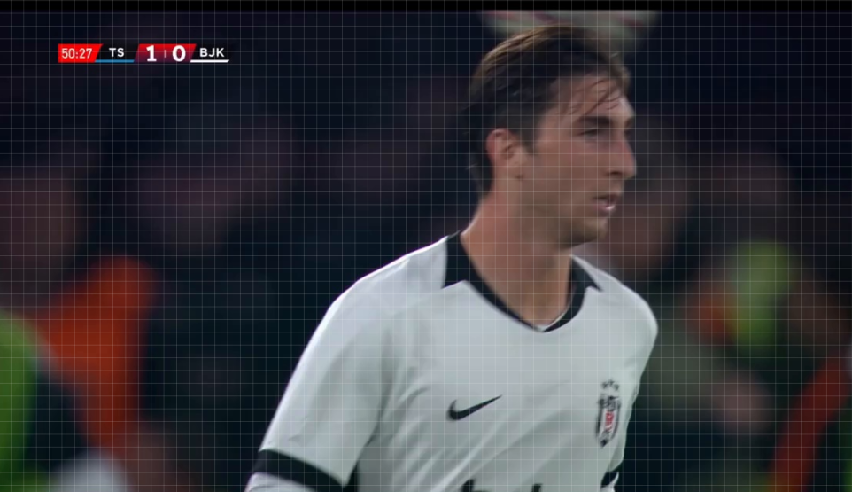
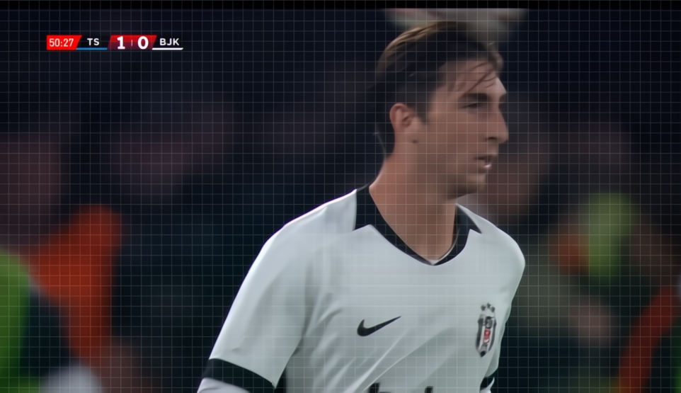
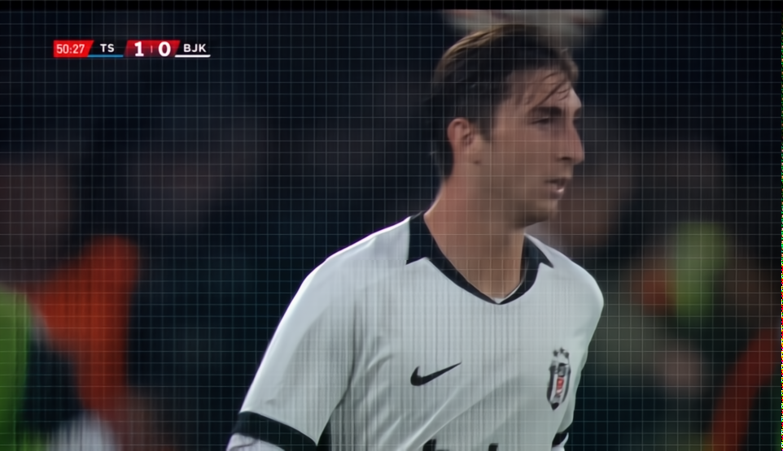

# Görüntü iyileştirme — bulanıklık ve JPEG bozulması

- **NAFNet-REDS:** Evrişim tabanlı bulanıklık giderme.
- **Concertormer-REDS:** Dikkat mekanizmalı bulanıklık ve JPEG bozulması giderme.

Giriş: JPEG/PNG. Çıkış: **aynı piksel boyutunda RGB PNG**. Bu bölüm metin okuma
veya nesne etiketleme yapmaz; videodan alınmış tekil kareler de işlenebilir.

## Dosyalar

| Dosya veya klasör | Görevi |
|---|---|
| `goruntu_iyilestirme_calistir.py` | İki iyileştirme motorunun komut satırı girişi |
| `iyilestirme_motorlari.py` | NAFNet/Concertormer yükleme, parçalama, karışım ve PNG üretimi |
| `concertormer_agirlik_hazirlama.py` | Sabit REDS ağırlığını indirme/doğrulama ve Safetensors'a dönüştürme |
| `concertormer_mimarisi/` | Concertormer ağının mimari kaynak kodu |
| `ornek_gorseller/01_orijinal.png` | İşlem öncesi kaynak alan |
| `ornek_gorseller/02_concertormer_reds_yuzde100.png` | Concertormer ile %100 model sonucu |
| `ornek_gorseller/03_nafnet_reds_yuzde100.png` | NAFNet ile %100 model sonucu |

## Hazırlama

**Bu klasöre girmeden, demo kök klasöründe çalıştırın.** Önce
[ortak kurulumu](../README.md#ortak-kurulum) tamamlayın, ardından:

```sh
python -m pip install -r goruntu_iyilestirme/requirements.txt
python goruntu_iyilestirme/goruntu_iyilestirme_calistir.py download --engine all --allow-network
python goruntu_iyilestirme/goruntu_iyilestirme_calistir.py check --engine all
```

`all` yalnız NAFNet ve Concertormer modellerini kapsar. Tek motor için `all`
yerine `nafnet-reds` veya `concertormer-reds` yazın.

NAFNet'in sabit ONNX ağırlığı resmî OpenCV deposundan indirilir. Concertormer
hazırlığı, geliştiricinin resmî Google Drive arşivinden yalnız REDS checkpoint'ini
HTTP byte-range ile alır. Boyut/hash doğrulaması ve `weights_only=True` yüklemesi
sonrası Safetensors'a dönüştürür. Sunucunun byte-range desteği gerekir;
tam arşiv indirmesine otomatik geçilmez.

## Deneme

```sh
python goruntu_iyilestirme/goruntu_iyilestirme_calistir.py restore --engine nafnet-reds --image goruntu_iyilestirme/ornek_gorseller/01_orijinal.png --output outputs/nafnet_iyilestirilmis.png --blend 1
python goruntu_iyilestirme/goruntu_iyilestirme_calistir.py restore --engine concertormer-reds --image goruntu_iyilestirme/ornek_gorseller/01_orijinal.png --output outputs/concertormer_iyilestirilmis.png --blend 1
```

`--blend 1` tamamen model sonucunu; `--blend 0.5` model ve girdinin yarı yarıya
karışımını verir. Aralık 0.1–1. NAFNet en fazla 4 milyon, Concertormer en fazla
1 milyon piksellik görsel işler. `--output`, girdiden farklı bir PNG yolu olmalıdır.

## Örnek karşılaştırma ve boyutlar

| Orijinal alan | Concertormer · Bulanıklık + JPEG (REDS) · %100 | NAFNet-REDS · %100 |
|---|---|---|
|  |  |  |

Üç dosya da **962 × 555 piksel** boyutundadır. Tam alan işlenmiştir; nihai
çözünürlük büyütülmemiş veya küçültülmemiştir. **%100, büyütme oranı değil,
model sonucunun karışımdaki payıdır.** PNG dosya boyutu piksel içeriği ve
sıkıştırılabilirlik değiştiği için farklı olabilir.

**NAFNet-REDS**, standart aktivasyonların yerine kapılama kullanan evrişim tabanlı
bir encoder-decoder ağıdır; burada ONNX Runtime ile çalışır. Görsel 320 piksel
çekirdek ve 32 piksel çevre bağlamıyla işlenir. Parçalar TLC pencereleri için
en az 384 piksele ve 16'nın katına geçici olarak tamamlanır. Yalnız çekirdek
bölgeler birleştirilir.

**Concertormer-REDS**, evrişim ve dikkat/Transformer bloklarını birleştirir.
Ağın içindeki çok ölçekli bilinear küçültme ve PixelShuffle büyütme, ara özellik
işlemleridir. Bu örnekte 384 piksel çekirdek ve 64 piksel çevre bağlamı kullanılır;
parçalar 64'ün katına tamamlanır. Dolgular çıkarılıp aynı alanlar birleştirilir.
Nihai görsel kaynakla aynı boyutta kalır; süper çözünürlük uygulanmaz.

Kareli çizgiler kaynak piksellerde de vardır. Daha keskin görünüm, kaybolan harf
veya logo ayrıntısının doğru üretildiğini tek başına kanıtlamaz.

## Python içinden

Demo kökünde çalışan bir Python betiğinde:

```python
import base64
from pathlib import Path
from ortak.motor_servisi import InferenceService

service = InferenceService(Path("models"))
result = service.restore(
    "nafnet-reds",
    Path("goruntu_iyilestirme/ornek_gorseller/01_orijinal.png").read_bytes(),
    blend=1.0,
)
Path("iyilestirilmis.png").write_bytes(base64.b64decode(result["image_base64"]))
```

Servisi ayrı bir çıkarım sürecinde kullanın. HTTP kullanımının açıklaması
[ana README](../README.md#isteğe-bağlı-ortak-http-api) içindedir.
